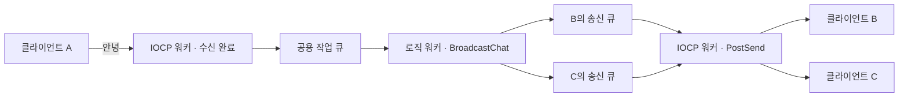

# IocpChat — Windows IOCP 멀티스레드 채팅 서버

클라이언트 A에서 `안녕`을 입력하면 같은 방에 접속한 B와 C의 콘솔에 `[사용자 1] 안녕`이 뜹니다. B와 C는 엔터를 누르지 않아도 받을 수 있습니다. 한 연결에서 받은 내용을 그대로 돌려주던 TCP 에코 서버를 여러 사람이 대화하는 채팅 서버로 확장한 C++ 프로젝트입니다.

`C++` · `Windows IOCP` · `Winsock2` · `Visual Studio 2019 / x64`

[빌드와 실행](#빌드와-실행) · [쓰레드와 큐](#쓰레드와-큐) · [채팅 한 줄의 흐름](#채팅-한-줄의-흐름) · [IOCP 동작 원리](#iocp-동작-원리) · [검증한 동작](#검증한-동작)

## 빌드와 실행

Windows에서 Visual Studio 2019, **C++를 사용한 데스크톱 개발**, MSVC v142, Windows 10 SDK가 필요합니다. 검증에 사용한 SDK는 `10.0.19041.0`입니다.

1. [Iocp.sln](Iocp.sln)을 열고 **Debug / x64**로 솔루션을 빌드합니다.
2. `x64\Debug\Iocp.exe`를 **한 번** 실행합니다. 서버에 `클라이언트 접속 대기 중: 127.0.0.1:9000`이 뜨면 준비된 상태입니다.
3. `x64\Debug\iocpClient.exe`를 **두 번** 실행합니다. 각 창의 입장 안내에서 내 번호를 확인합니다.
4. 첫 번째 창에 `안녕`을 입력합니다. 첫 번째 창의 번호가 1이면, 두 번째 창에 `[사용자 1] 안녕`이 표시됩니다. 두 번째 창에서 답장하면 첫 번째 창에도 표시됩니다.

기본 주소는 같은 PC에서 접속하는 `127.0.0.1:9000`입니다. 서버 시작 시 오류 `10048`이 뜨면 이미 실행 중인 서버가 9000번 포트를 사용하고 있는지 확인하세요. Visual Studio 2019 개발자 명령 프롬프트에서도 빌드할 수 있습니다.

```bat
msbuild Iocp.sln /m /p:Configuration=Debug /p:Platform=x64 /p:WindowsTargetPlatformVersion=10.0.19041.0
```

| 클라이언트 입력 | 동작 |
|---|---|
| 일반 텍스트 | 보낸 사람을 제외한 같은 방의 접속자에게 한 줄 전송 |
| `/repeat 3 안녕` | 같은 메시지를 세 번 전송. 반복 횟수는 1~100 |
| `/reconnect` | 기존 연결을 정리하고 새 접속 번호로 재입장 |
| `/quit` | 연결을 닫고 클라이언트 종료 |

## 쓰레드와 큐

| 서버 쓰레드 | 개수 | 역할 |
|---|---:|---|
| 메인 | 1 | `accept`로 접속을 받고, 소켓을 IOCP에 연결한 뒤 첫 수신을 워커에 요청 |
| IOCP 워커 | 2 | 같은 IOCP에서 완료 통지를 꺼내 수신 버퍼를 처리하고 비동기 송신을 등록 |
| 로직 워커 | 2 | 공용 작업 큐에서 채팅 한 줄을 꺼내 받는 사람들의 송신 큐에 배분 |

**공용 작업 큐**에는 보낸 사람과 채팅 본문이 들어갑니다. 로직 워커가 배분한 뒤에는 **각 세션의 송신 큐**에 그 사람에게 보낼 문자열이 들어갑니다. **IOCP 완료 큐**에는 소켓의 수신·송신 완료와 서버가 직접 넣은 작업 알림이 들어갑니다.



## 채팅 한 줄의 흐름

| 순서 | 코드에서 볼 곳 | A가 B에게 보낼 때 |
|---|---|---|
| 1 | [TakeChatLine](Common.h#L66) · [ContinueReceiveLocked](Iocp.cpp#L197) | A에게 받은 바이트를 이어 붙입니다. 줄바꿈까지 도착하면 한 줄을 공용 작업 큐에 넣습니다. |
| 2 | [CJobQueue::Push](JobQueue.cpp) · [RunLogicWorker](Iocp.cpp#L368) | 작업을 넣고 `notify_one()`으로 기다리던 로직 워커 하나를 깨웁니다. |
| 3 | [BroadcastChat](Iocp.cpp#L349) | 보낸 사람 A를 건너뛰고 B의 세션을 `QueueSendLocked`에 넘깁니다. |
| 4 | [QueueSendLocked](Iocp.cpp#L178) · [PostNotice](Iocp.cpp#L163) | B의 큐에 문자열을 넣습니다. 빈 큐에 첫 줄이 들어오면 `Notice::StartSend`와 B 세션을 담아 IOCP에 알립니다. |
| 5 | [RunIocpWorker](Iocp.cpp#L300) · [PostSend](Iocp.cpp#L117) | IOCP 워커가 알림을 꺼내 B의 소켓에 `WSASend`를 등록합니다. 맨 앞줄 전체의 송신이 완료되면 큐에서 지우고 다음 줄을 보냅니다. |
| 6 | [RunChatReceiver](iocpClient/iocpClient.cpp#L46) | B의 수신 쓰레드가 완성된 한 줄을 출력합니다. 콘솔 입력은 별도 쓰레드에서 기다립니다. |

B가 입력을 기다리는 동안에도 송신할 수 있도록 각 세션은 수신과 송신에 별도의 `OVERLAPPED`를 사용합니다. 본문은 한 줄에 최대 4,096바이트입니다. 특정 접속의 송신 대기량이 256 KiB를 넘으면 그 연결을 정리합니다.

## IOCP 동작 원리

### IOCP와 GQCS

IOCP(I/O Completion Port)는 여러 소켓의 비동기 입출력 완료 통지를 한곳에서 받는 Windows 커널 객체입니다. 이 서버는 `CreateIoCompletionPort`를 두 가지 용도로 사용합니다. 처음에는 `INVALID_HANDLE_VALUE`를 넘겨 포트를 만들고, 이후에는 `accept`로 받은 소켓을 그 포트에 연결합니다. 이때 세션 주소를 완료 키로 지정해 두면, 어느 워커가 통지를 꺼내더라도 해당 접속을 찾을 수 있습니다. [포트 생성](Iocp.cpp#L494) · [소켓 연결](Iocp.cpp#L540)

```cpp
const BOOL success = GetQueuedCompletionStatus(context.completionPort,
    &bytes, &completionKey, &p_overlapped, INFINITE);
```

`GetQueuedCompletionStatus`(GQCS)는 완료 큐에서 통지 한 건을 꺼냅니다. 큐가 비어 있으면 워커는 함수 안에서 대기합니다. 통지가 들어오면 Windows가 포트의 동시 실행 한도에 따라 대기 중인 워커 하나를 실행할 수 있게 합니다. 워커가 모두 작업 중이면 통지는 큐에 남고, 다음 GQCS 호출이 가져갑니다. 워커가 소켓마다 반복해서 수신 여부를 확인할 필요가 없어 여러 접속을 같은 워커들로 처리할 수 있습니다. [워커 대기 루프](Iocp.cpp#L312) · [Microsoft의 IOCP 동작 설명](https://learn.microsoft.com/en-us/windows/win32/fileio/i-o-completion-ports)

이 프로젝트는 **IOCP 워커 2개**와 **포트의 동시 실행 한도 2**를 각각 설정합니다. 워커 수는 서버가 직접 만든 쓰레드 수이고, 동시 실행 한도는 Windows가 해당 포트에서 동시에 실행 가능하게 하는 워커 수를 제어합니다. 포트를 만들 때 넘긴 숫자가 쓰레드를 생성하지는 않습니다. [한도 설정](Iocp.cpp#L494) · [워커 생성](Iocp.cpp#L510)

### 수신 완료와 워커 간 알림

A가 `D`를 입력하고 엔터를 눌렀다고 가정합니다. 서버가 A의 버퍼로 `WSARecv`를 미리 등록했고, 이번 수신에서 `D\n` 두 바이트가 한 번에 도착한 경우입니다.

1. **Windows가 IOCP 워커를 깨웁니다.** Windows는 A의 버퍼를 채운 뒤 수신 완료 통지를 넣습니다. GQCS에서 돌아온 워커는 `completionKey`로 **누구의 접속인지**, `p_overlapped`로 **어떤 작업인지**, `bytes`로 **몇 바이트가 완료됐는지** 확인합니다. 채팅 본문은 A의 수신 버퍼에 있습니다. [수신 등록](Iocp.cpp#L111) · [완료 처리](Iocp.cpp#L262)
2. **IOCP 워커가 로직 워커를 깨웁니다.** 줄바꿈까지 모이면 A의 세션과 본문 `D`를 공용 작업 큐에 넣고 `notify_one()`을 호출합니다. 이때 깨어나는 대상은 그 큐의 조건 변수에서 대기하던 로직 워커입니다. [작업 추가와 알림](JobQueue.cpp#L14) · [로직 워커의 대기](JobQueue.cpp#L22)
3. **로직 워커가 IOCP 워커에 송신을 요청합니다.** 로직 워커는 B에게 보낼 문자열을 B의 송신 큐에 넣습니다. 빈 큐에 첫 줄을 넣었으면 `PostQueuedCompletionStatus`로 `StartSend`와 B 세션을 담은 알림 객체의 주소를 보냅니다. IOCP 워커는 GQCS에서 그 주소를 받아 `notice.type`을 읽고, `case Notice::StartSend`에서 B의 `WSASend`를 등록합니다. [B의 큐에 추가](Iocp.cpp#L189) · [알림 등록](Iocp.cpp#L168) · [송신 분기](Iocp.cpp#L245)

같은 GQCS 호출에서도 반환값의 의미는 통지 종류에 따라 달라집니다. 디버거에서 [GQCS 직후](Iocp.cpp#L314)에 멈추면 아래 값을 함께 볼 수 있습니다. [직접 등록한 알림의 인자 전달 규칙](https://learn.microsoft.com/en-us/windows/win32/api/ioapiset/nf-ioapiset-postqueuedcompletionstatus)

| 이 서버에서 꺼낸 통지 | `bytes` | `completionKey` | `p_overlapped` |
|---|---|---|---|
| A의 수신 완료 | 이번에 받은 바이트 수 | A의 세션 주소 | A의 `recvOverlapped` 주소 |
| B의 송신 완료 | 이번에 송신 완료된 바이트 수 | B의 세션 주소 | B의 `sendOverlapped` 주소 |
| 서버가 등록한 `StartSend` | 0 | `StartSend`와 B 세션을 담은 `stNotice` 주소 | `nullptr` |
| 서버가 등록한 워커 종료 알림 | 0 | 0 | `nullptr` |

### 요청 등록, 완료, 연결 종료

**요청 등록과 완료는 시점이 다릅니다.** `WSARecv`가 `SOCKET_ERROR`를 반환해도 `WSAGetLastError()`가 `WSA_IO_PENDING`이면 요청은 정상 등록된 상태입니다. 반대로 즉시 성공해도 이 서버 설정에서는 완료 통지가 들어옵니다. 두 경우 모두 실제 데이터 처리는 GQCS 경로에서 한 번만 수행합니다. [요청 등록 판정](Iocp.cpp#L89) · [WSARecv 문서](https://learn.microsoft.com/en-us/windows/win32/api/winsock2/nf-winsock2-wsarecv)

**완료 결과는 반환값과 포인터를 함께 보고 해석합니다.** GQCS가 `FALSE`이고 `p_overlapped`가 있으면 실패한 I/O의 통지를 꺼낸 것입니다. `GetLastError()`로 오류를 확인하고 해당 작업을 정리합니다. `FALSE`이고 포인터도 비어 있으면 꺼낸 통지가 없습니다. 반면 길이가 양수인 TCP 수신이 **성공하면서 0바이트**이면 상대가 송신 방향을 정상 종료한 것입니다. 위 표에서 보듯 서버가 직접 넣은 알림도 `bytes`가 0이므로 먼저 통지의 종류를 구분해야 합니다. [완료 처리 분기](Iocp.cpp#L316) · [GQCS 반환값 문서](https://learn.microsoft.com/en-us/windows/win32/api/ioapiset/nf-ioapiset-getqueuedcompletionstatus)

**송신 완료는 로컬 전송 계층이 해당 바이트를 처리했다는 뜻입니다.** 일부만 완료되면 서버는 남은 구간부터 다시 보냅니다. B의 프로그램이 메시지를 받거나 화면에 표시했는지까지 서버에서 확인하려면, B가 보낸 수신 확인 응답이 별도로 필요합니다. [부분 송신 처리](Iocp.cpp#L287) · [WSASend 문서](https://learn.microsoft.com/en-us/windows/win32/api/winsock2/nf-winsock2-wsasend)

### 세션 수명과 메시지 순서

B가 새 입력을 기다리는 도중에도 A의 글을 B에게 보낼 수 있어야 합니다. 그래서 각 세션은 수신과 송신에 별도의 `OVERLAPPED`와 버퍼를 사용합니다. 한 작업이 끝날 때까지 그 작업의 메모리는 유효해야 하므로, 송신 중인 문자열은 큐의 맨 앞에 유지합니다. 소켓을 닫을 때도 진행 중인 수신·송신의 마지막 완료 통지를 회수한 뒤 세션을 목록에서 제거합니다. [세션의 입출력 상태](Iocp.cpp#L23) · [세션 정리 조건](Iocp.cpp#L155)

완료 통지는 등록된 순서(FIFO)로 큐에 쌓입니다. 반면 대기 중인 워커를 선택할 때는 보통 가장 최근에 대기에 들어간 워커가 먼저 선택됩니다(LIFO). 여러 워커가 통지를 꺼내 작업하면 실제 처리가 끝나는 순서도 달라질 수 있습니다. 이 서버는 순서를 두 곳에서 보장합니다. **보내는 쪽**은 A의 앞줄을 로직 워커가 배분하고 `ReceiveNext`를 등록해야 A의 다음 줄을 넘깁니다. **받는 쪽**은 B의 송신 큐에서 한 번에 한 줄만 송신하고, 그 줄 전체가 완료돼야 다음 줄을 시작합니다. A의 다음 작업을 다른 IOCP 워커가 맡더라도 이 규칙은 유지됩니다. [A의 다음 수신](Iocp.cpp#L380) · [B의 다음 송신](Iocp.cpp#L296)

## 검증한 동작

- 클라이언트 세 개에서 한글 채팅, 입력 중이 아닌 두 상대에게 전달, 반대 방향 답장, 반복 전송, 재접속과 종료를 확인했습니다.
- 두 사람이 동시에 40줄씩 보냈을 때 별도의 두 수신자가 총 80줄을 빠짐없이 같은 순서로 받았습니다.
- 한글 한 글자의 바이트가 여러 수신으로 나뉜 경우, 여러 줄이 한 번에 도착한 경우, 4,096바이트 본문과 줄 끝이 나뉜 경우를 확인했습니다.
- 제한을 넘긴 접속이 끊어진 뒤에도 남은 접속끼리 계속 대화할 수 있었습니다.
