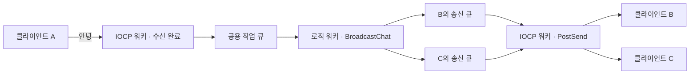

# IocpChat — Windows IOCP 멀티스레드 채팅 서버

클라이언트 A에서 `안녕`을 입력하면 같은 방에 접속한 B와 C의 콘솔에 `[사용자 1] 안녕`이 뜹니다. B와 C는 엔터를 누르지 않아도 받을 수 있습니다. 한 연결에서 받은 내용을 그대로 돌려주던 TCP 에코 서버를 여러 사람이 대화하는 채팅 서버로 확장한 C++ 프로젝트입니다.

`C++` · `Windows IOCP` · `Winsock2` · `Visual Studio 2019 / x64`

[빌드와 실행](#빌드와-실행) · [쓰레드와 큐](#쓰레드와-큐) · [채팅 한 줄의 흐름](#채팅-한-줄의-흐름) · [IOCP와 GQCS](#iocp와-gqcs) · [IOCP 면접 질문](#iocp-면접-질문) · [검증한 동작](#검증한-동작)

## 빌드와 실행

Windows에서 Visual Studio 2019, **C++를 사용한 데스크톱 개발**, MSVC v142, Windows 10 SDK가 필요합니다. 검증에 사용한 SDK는 `10.0.19041.0`입니다.

1. [Iocp.sln](Iocp.sln)을 열고 **Debug / x64**로 솔루션을 빌드합니다.
2. `x64\Debug\Iocp.exe`를 **한 번** 실행합니다. 서버에 `클라이언트 접속 대기 중: 127.0.0.1:9000`이 뜨면 준비된 상태입니다.
3. `x64\Debug\iocpClient.exe`를 **두 번** 실행합니다. 각 창의 입장 안내에서 내 번호를 확인합니다.
4. 첫 번째 창에 `안녕`을 입력합니다. 첫 번째 창의 번호가 1이면, 두 번째 창에 `[사용자 1] 안녕`이 표시됩니다. 두 번째 창에서 답장하면 첫 번째 창에도 표시됩니다.

기본 주소는 같은 PC에서 접속하는 `127.0.0.1:9000`입니다. 서버 시작 시 오류 `10048`이 뜨면 이미 실행 중인 서버가 9000번 포트를 사용하고 있는지 확인하세요. Visual Studio 2019 개발자 명령 프롬프트에서도 빌드할 수 있습니다.

```bat
msbuild Iocp.sln /m /p:Configuration=Debug /p:Platform=x64 /p:WindowsTargetPlatformVersion=10.0.19041.0
```

| 클라이언트 입력 | 동작 |
|---|---|
| 일반 텍스트 | 보낸 사람을 제외한 같은 방의 접속자에게 한 줄 전송 |
| `/repeat 3 안녕` | 같은 메시지를 세 번 전송. 반복 횟수는 1~100 |
| `/reconnect` | 기존 연결을 정리하고 새 접속 번호로 재입장 |
| `/quit` | 연결을 닫고 클라이언트 종료 |

## 쓰레드와 큐

| 서버 쓰레드 | 개수 | 역할 |
|---|---:|---|
| 메인 | 1 | `accept`로 접속을 받고, 소켓을 IOCP에 연결한 뒤 첫 수신을 워커에 요청 |
| IOCP 워커 | 2 | 같은 IOCP에서 완료 통지를 꺼내 수신 버퍼를 처리하고 비동기 송신을 등록 |
| 로직 워커 | 2 | 공용 작업 큐에서 채팅 한 줄을 꺼내 받는 사람들의 송신 큐에 배분 |

**공용 작업 큐**에는 보낸 사람과 채팅 본문이 들어갑니다. 로직 워커가 배분한 뒤에는 **각 세션의 송신 큐**에 그 사람에게 보낼 문자열이 들어갑니다. **IOCP 완료 큐**에는 소켓의 수신·송신 완료와 서버가 직접 넣은 작업 알림이 들어갑니다.



## 채팅 한 줄의 흐름

| 순서 | 코드에서 볼 곳 | A가 B에게 보낼 때 |
|---|---|---|
| 1 | [TakeChatLine](Common.h#L66) · [ContinueReceiveLocked](Iocp.cpp#L197) | A에게 받은 바이트를 이어 붙입니다. 줄바꿈까지 도착하면 한 줄을 공용 작업 큐에 넣습니다. |
| 2 | [CJobQueue::Push](JobQueue.cpp) · [RunLogicWorker](Iocp.cpp#L368) | 작업을 넣고 `notify_one()`으로 기다리던 로직 워커 하나를 깨웁니다. |
| 3 | [BroadcastChat](Iocp.cpp#L349) | 보낸 사람 A를 건너뛰고 B의 세션을 `QueueSendLocked`에 넘깁니다. |
| 4 | [QueueSendLocked](Iocp.cpp#L178) · [PostNotice](Iocp.cpp#L163) | B의 큐에 문자열을 넣습니다. 빈 큐에 첫 줄이 들어오면 `Notice::StartSend`와 B 세션을 담아 IOCP에 알립니다. |
| 5 | [RunIocpWorker](Iocp.cpp#L300) · [PostSend](Iocp.cpp#L117) | IOCP 워커가 알림을 꺼내 B의 소켓에 `WSASend`를 등록합니다. 맨 앞줄 전체의 송신이 완료되면 큐에서 지우고 다음 줄을 보냅니다. |
| 6 | [RunChatReceiver](iocpClient/iocpClient.cpp#L46) | B의 수신 쓰레드가 완성된 한 줄을 출력합니다. 콘솔 입력은 별도 쓰레드에서 기다립니다. |

B가 입력을 기다리는 동안에도 송신할 수 있도록 각 세션은 수신과 송신에 별도의 `OVERLAPPED`를 사용합니다. 본문은 한 줄에 최대 4,096바이트입니다. 특정 접속의 송신 대기량이 256 KiB를 넘으면 그 연결을 정리합니다.

## IOCP와 GQCS

서버는 `CreateIoCompletionPort`를 두 가지 용도로 호출합니다. 처음에는 `INVALID_HANDLE_VALUE`를 넘겨 Windows가 관리하는 완료 큐를 만듭니다. 그다음부터는 `accept`로 받은 소켓을 기존 포트에 연결하고, 완료 키로 그 클라이언트의 세션 주소를 지정합니다. 이제 A의 수신과 B의 송신이 끝나면 같은 큐에서 두 소켓의 완료를 확인할 수 있습니다. [포트 생성](Iocp.cpp#L494) · [소켓 연결](Iocp.cpp#L540)

**누가 워커를 깨우나?** IOCP 워커 두 개는 각각 아래 함수를 호출합니다. 큐에 통지가 있으면 `GetQueuedCompletionStatus`(GQCS)가 한 건을 꺼내 반환합니다. 큐가 비어 있으면 호출한 워커는 Windows 안에서 대기합니다. 여기서는 대기 시간이 `INFINITE`라 통지가 올 때까지 루프를 돌며 큐를 다시 확인할 필요가 없습니다. 새 통지가 들어오면 Windows가 포트의 동시 실행 한도에 따라 대기 중인 워커 하나가 그 통지를 처리하도록 합니다. 둘 다 일하고 있으면 통지는 큐에 남고, 워커가 다시 GQCS를 호출했을 때 꺼냅니다. [워커의 대기 루프](Iocp.cpp#L312) · [Microsoft의 IOCP 동작 설명](https://learn.microsoft.com/en-us/windows/win32/fileio/i-o-completion-ports)

```cpp
const BOOL success = GetQueuedCompletionStatus(context.completionPort,
    &bytes, &completionKey, &p_overlapped, INFINITE);
```

| 이 서버에서 꺼낸 통지 | `bytes` | `completionKey` | `p_overlapped` |
|---|---|---|---|
| A의 수신 완료 | 이번에 받은 바이트 수 | A의 세션 주소 | A의 `recvOverlapped` 주소 |
| B의 송신 완료 | 이번에 송신 완료된 바이트 수 | B의 세션 주소 | B의 `sendOverlapped` 주소 |
| 서버가 직접 넣은 `StartSend` 알림 | 0 | `stNotice` 주소. 객체에 `StartSend`와 B 세션이 들어 있음 | `nullptr` |
| 워커 종료 알림 | 0 | 0 | `nullptr` |

A가 `D`를 입력하고 엔터를 눌렀다고 가정해 보겠습니다. 이 예에서는 `D\n` 두 바이트가 한 번에 도착하고 B의 송신 큐가 비어 있습니다.

1. **Windows → IOCP 워커.** 서버는 접속 직후 `WSARecv`에 A의 수신 버퍼를 미리 등록했습니다. Windows가 버퍼에 두 바이트를 채우고 수신 완료 통지를 넣습니다. GQCS에서 돌아온 워커는 세션 주소로 **A의 작업**임을, `OVERLAPPED` 주소로 **수신 완료**임을 확인합니다. 본문 `D\n`은 A의 수신 버퍼에 있습니다. [수신 등록](Iocp.cpp#L111) · [완료 구분](Iocp.cpp#L262)
2. **IOCP 워커 → 로직 워커.** 줄바꿈까지 모이면 IOCP 워커가 A와 본문 `D`를 공용 작업 큐에 넣고 `notify_one()`을 호출합니다. 여기서 깨우는 대상은 `CJobQueue::Pop()`에서 기다리던 **로직 워커**입니다. [깨우는 곳](JobQueue.cpp#L14) · [기다리는 곳](JobQueue.cpp#L22)
3. **로직 워커 → IOCP 워커.** 로직 워커는 B의 송신 큐에 채팅을 넣고 `PostNotice(context, Notice::StartSend, sp_session)`을 호출합니다. `PostNotice`는 알림 객체의 주소를 `PostQueuedCompletionStatus`로 IOCP에 넣습니다. GQCS가 그 주소를 돌려주면 IOCP 워커는 객체의 `notice.type`을 읽고 `case Notice::StartSend`에서 B의 `WSASend`를 등록합니다. [알림 생성](Iocp.cpp#L163) · [StartSend 분기](Iocp.cpp#L245)
4. **Windows → IOCP 워커.** B의 송신이 완료되면 Windows가 이번에는 B의 `sendOverlapped` 주소로 완료 통지를 넣습니다. 워커는 완료된 바이트 수만큼 위치를 옮깁니다. 일부만 보냈으면 같은 줄의 나머지를 보내고, 한 줄을 다 보냈으면 큐에서 제거합니다. B의 화면에 텍스트를 출력하는 일은 B의 클라이언트가 맡습니다. [송신 완료 처리](Iocp.cpp#L287) · [클라이언트 수신](iocpClient/iocpClient.cpp#L46)

디버거에서는 [GQCS 다음 줄](Iocp.cpp#L314)에 중단점을 잡고 `bytes`, `completionKey`, `p_overlapped`를 함께 보면 위 표와 대응됩니다. 같은 포트에는 접속 알림 `NewSession`과 A의 다음 줄을 처리하라는 `ReceiveNext`도 들어옵니다. [직접 넣은 알림의 처리](Iocp.cpp#L333) · [PostQueuedCompletionStatus 문서](https://learn.microsoft.com/en-us/windows/win32/api/ioapiset/nf-ioapiset-postqueuedcompletionstatus)

## IOCP 면접 질문

**1. 워커 수와 IOCP의 동시 실행 한도는 어떻게 다른가요?**

워커 수는 서버가 `thread(RunIocpWorker, ...)`로 몇 개의 쓰레드를 만드는지입니다. IOCP 생성 시의 마지막 인자는 그 포트에서 동시에 실행 가능한 워커 수를 제한합니다. 이 프로젝트는 둘 다 2로 설정합니다. 워커를 4개 만들고 한도를 2로 설정하면 네 워커가 같은 포트를 사용할 수 있고, Windows는 그중 실행 가능한 워커 수를 한도에 맞춰 조절합니다. 로직 워커는 별도의 조건 변수에서 기다립니다. [한도 설정](Iocp.cpp#L494) · [쓰레드 생성](Iocp.cpp#L510)

**2. A의 수신을 처리한 워커가 다음에도 A를 담당하나요? 순서는 어떻게 보장하나요?**

다음 통지는 다른 워커가 가져갈 수 있습니다. 완료 통지가 FIFO로 쌓여도 두 워커가 실제로 처리를 끝내는 순서는 달라질 수 있습니다. 이 서버는 같은 사람이 보낸 채팅을 공용 큐에 한 줄씩 넘깁니다. 로직 워커가 앞줄을 배분하고 `ReceiveNext`를 보내야 그 사람의 다음 줄을 처리하므로, 같은 사람이 연달아 보낸 두 줄의 순서가 유지됩니다. [한 줄씩 넘기는 코드](Iocp.cpp#L197) · [ReceiveNext 등록](Iocp.cpp#L380)

**3. `WSARecv`가 `SOCKET_ERROR`를 반환하면 연결을 닫아야 하나요?**

먼저 `WSAGetLastError()`를 확인합니다. `WSA_IO_PENDING`이면 수신 요청이 정상 등록됐고 완료를 기다리는 상태입니다. 즉시 성공한 경우에도 이 서버 설정에서는 완료 통지가 오므로 두 경우 모두 GQCS 쪽에서 한 번만 처리합니다. [요청 등록 판정](Iocp.cpp#L89) · [WSARecv 문서](https://learn.microsoft.com/en-us/windows/win32/api/winsock2/nf-winsock2-wsarecv)

**4. GQCS가 `FALSE`를 반환한 경우와 0바이트 수신은 어떻게 구분하나요?**

`FALSE`이고 `p_overlapped`가 있으면 실패한 I/O의 완료 통지를 꺼낸 것입니다. 즉시 `GetLastError()`로 원인을 읽고 해당 세션의 작업을 정리합니다. `FALSE`이고 포인터도 비어 있으면 꺼낸 통지가 없습니다. 반면 이 서버처럼 길이가 양수인 TCP 수신을 등록한 뒤 **성공한 수신 완료가 0바이트**이면 상대가 송신 방향을 정상 종료한 것입니다. 직접 넣은 `StartSend`도 `bytes`가 0이므로 바이트 수만으로 연결 종료를 판단할 수 없습니다. [GQCS 분기](Iocp.cpp#L312) · [GQCS 반환값 문서](https://learn.microsoft.com/en-us/windows/win32/api/ioapiset/nf-ioapiset-getqueuedcompletionstatus)

**5. 왜 수신과 송신에 서로 다른 `OVERLAPPED`와 버퍼가 필요한가요?**

B에게는 다음 입력을 기다리는 수신과 A의 글을 전달하는 송신이 동시에 걸릴 수 있습니다. 각각의 작업이 끝날 때까지 Windows가 참조하는 `OVERLAPPED`와 버퍼가 유효해야 합니다. 수신에는 세션의 수신 버퍼를, 송신에는 송신 큐의 맨 앞 문자열을 사용합니다. 연결 종료 때도 남은 I/O 완료를 회수한 뒤 세션을 목록에서 제거합니다. [세션의 수신·송신 상태](Iocp.cpp#L23) · [세션 정리](Iocp.cpp#L143)

**6. 송신 완료 통지를 받으면 B가 글을 읽었다고 말할 수 있나요?**

송신 완료는 로컬 전송 계층이 이번 요청의 바이트를 받아 처리했다는 뜻입니다. B의 프로그램이 글을 받거나 출력했는지 서버가 확인하려면, B가 메시지 번호와 함께 수신 확인 응답을 보내는 규칙을 별도로 정해야 합니다. [송신 등록](Iocp.cpp#L123) · [WSASend 문서](https://learn.microsoft.com/en-us/windows/win32/api/winsock2/nf-winsock2-wsasend)

## 검증한 동작

- 클라이언트 세 개에서 한글 채팅, 입력 중이 아닌 두 상대에게 전달, 반대 방향 답장, 반복 전송, 재접속과 종료를 확인했습니다.
- 두 사람이 동시에 40줄씩 보냈을 때 별도의 두 수신자가 총 80줄을 빠짐없이 같은 순서로 받았습니다.
- 한글 한 글자의 바이트가 여러 수신으로 나뉜 경우, 여러 줄이 한 번에 도착한 경우, 4,096바이트 본문과 줄 끝이 나뉜 경우를 확인했습니다.
- 제한을 넘긴 접속이 끊어진 뒤에도 남은 접속끼리 계속 대화할 수 있었습니다.
