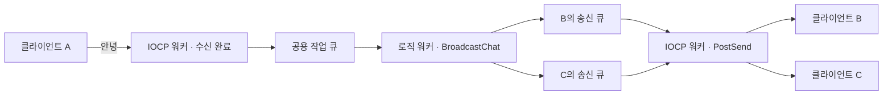

# IocpChat — Windows IOCP 멀티스레드 채팅 서버

클라이언트 A에서 `안녕`을 입력하면 같은 방에 접속한 B와 C의 콘솔에 `[사용자 1] 안녕`이 뜹니다. B와 C는 엔터를 누르지 않아도 받을 수 있습니다. 한 연결에서 받은 내용을 그대로 돌려주던 TCP 에코 서버를 여러 사람이 대화하는 채팅 서버로 확장한 C++ 프로젝트입니다.

`C++` · `Windows IOCP` · `Winsock2` · `Visual Studio 2019 / x64`

[빌드와 실행](#빌드와-실행) · [쓰레드와 큐](#쓰레드와-큐) · [채팅 한 줄의 흐름](#채팅-한-줄의-흐름) · [검증한 동작](#검증한-동작)

## 빌드와 실행

Windows에서 Visual Studio 2019, **C++를 사용한 데스크톱 개발**, MSVC v142, Windows 10 SDK가 필요합니다. 검증에 사용한 SDK는 `10.0.19041.0`입니다.

1. [Iocp.sln](Iocp.sln)을 열고 **Debug / x64**로 솔루션을 빌드합니다.
2. `x64\Debug\Iocp.exe`를 **한 번** 실행합니다. 서버에 `클라이언트 접속 대기 중: 127.0.0.1:9000`이 뜨면 준비된 상태입니다.
3. `x64\Debug\iocpClient.exe`를 **두 번** 실행합니다. 각 창의 입장 안내에서 내 번호를 확인합니다.
4. 첫 번째 창에 `안녕`을 입력합니다. 첫 번째 창의 번호가 1이면, 두 번째 창에 `[사용자 1] 안녕`이 표시됩니다. 두 번째 창에서 답장하면 첫 번째 창에도 표시됩니다.

기본 주소는 같은 PC에서 접속하는 `127.0.0.1:9000`입니다. 서버 시작 시 오류 `10048`이 뜨면 이미 실행 중인 서버가 9000번 포트를 사용하고 있는지 확인하세요. Visual Studio 2019 개발자 명령 프롬프트에서도 빌드할 수 있습니다.

```bat
msbuild Iocp.sln /m /p:Configuration=Debug /p:Platform=x64 /p:WindowsTargetPlatformVersion=10.0.19041.0
```

| 클라이언트 입력 | 동작 |
|---|---|
| 일반 텍스트 | 보낸 사람을 제외한 같은 방의 접속자에게 한 줄 전송 |
| `/repeat 3 안녕` | 같은 메시지를 세 번 전송. 반복 횟수는 1~100 |
| `/reconnect` | 기존 연결을 정리하고 새 접속 번호로 재입장 |
| `/quit` | 연결을 닫고 클라이언트 종료 |

## 쓰레드와 큐

| 서버 쓰레드 | 개수 | 역할 |
|---|---:|---|
| 메인 | 1 | `accept`로 접속을 받고, 소켓을 IOCP에 연결한 뒤 첫 수신을 워커에 요청 |
| IOCP 워커 | 2 | 같은 IOCP에서 완료 통지를 꺼내 수신 버퍼를 처리하고 비동기 송신을 등록 |
| 로직 워커 | 2 | 공용 작업 큐에서 채팅 한 줄을 꺼내 받는 사람들의 송신 큐에 배분 |

**공용 작업 큐**에는 보낸 사람과 채팅 본문이 들어갑니다. 로직 워커가 배분한 뒤에는 **각 세션의 송신 큐**에 그 사람에게 보낼 문자열이 들어갑니다. **IOCP 완료 큐**에는 소켓의 수신·송신 완료와 서버가 직접 넣은 작업 알림이 들어갑니다.



## 채팅 한 줄의 흐름

| 순서 | 코드에서 볼 곳 | A가 B에게 보낼 때 |
|---|---|---|
| 1 | [TakeChatLine](Common.h#L66) · [ContinueReceiveLocked](Iocp.cpp#L197) | A에게 받은 바이트를 이어 붙입니다. 줄바꿈까지 도착하면 한 줄을 공용 작업 큐에 넣습니다. |
| 2 | [CJobQueue::Push](JobQueue.cpp) · [RunLogicWorker](Iocp.cpp#L368) | 작업을 넣고 `notify_one()`으로 기다리던 로직 워커 하나를 깨웁니다. |
| 3 | [BroadcastChat](Iocp.cpp#L349) | 보낸 사람 A를 건너뛰고 B의 세션을 `QueueSendLocked`에 넘깁니다. |
| 4 | [QueueSendLocked](Iocp.cpp#L178) · [PostNotice](Iocp.cpp#L163) | B의 큐에 문자열을 넣습니다. 빈 큐에 첫 줄이 들어오면 `Notice::StartSend`와 B 세션을 담아 IOCP에 알립니다. |
| 5 | [RunIocpWorker](Iocp.cpp#L300) · [PostSend](Iocp.cpp#L117) | IOCP 워커가 알림을 꺼내 B의 소켓에 `WSASend`를 등록합니다. 맨 앞줄 전체의 송신이 완료되면 큐에서 지우고 다음 줄을 보냅니다. |
| 6 | [RunChatReceiver](iocpClient/iocpClient.cpp#L46) | B의 수신 쓰레드가 완성된 한 줄을 출력합니다. 콘솔 입력은 별도 쓰레드에서 기다립니다. |

B가 입력을 기다리는 동안에도 송신할 수 있도록 각 세션은 수신과 송신에 별도의 `OVERLAPPED`를 사용합니다. 본문은 한 줄에 최대 4,096바이트입니다. 특정 접속의 송신 대기량이 256 KiB를 넘으면 그 연결을 정리합니다.

## 검증한 동작

- 클라이언트 세 개에서 한글 채팅, 입력 중이 아닌 두 상대에게 전달, 반대 방향 답장, 반복 전송, 재접속과 종료를 확인했습니다.
- 두 사람이 동시에 40줄씩 보냈을 때 별도의 두 수신자가 총 80줄을 빠짐없이 같은 순서로 받았습니다.
- 한글 한 글자의 바이트가 여러 수신으로 나뉜 경우, 여러 줄이 한 번에 도착한 경우, 4,096바이트 본문과 줄 끝이 나뉜 경우를 확인했습니다.
- 제한을 넘긴 접속이 끊어진 뒤에도 남은 접속끼리 계속 대화할 수 있었습니다.
